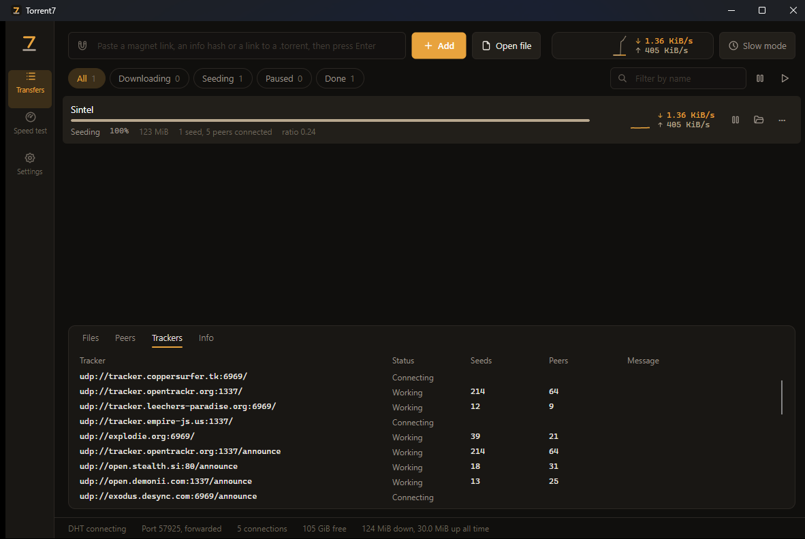
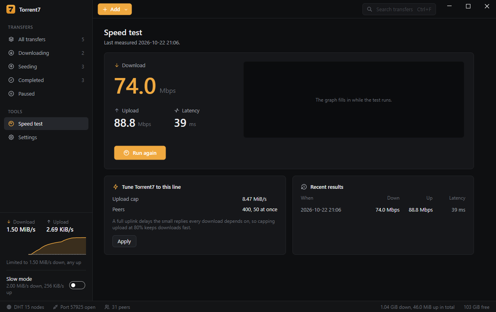

<div align="center">


# Torrent7

### Paste a link, get the file. Fast, small, and it runs on any PC.

**A free torrent client for Windows and Linux, with a speed test and an autotuner built in.**

[](https://github.com/SeventhSG/Torrent7/actions/workflows/build.yml)
[](https://github.com/SeventhSG/Torrent7/releases/latest)
[](LICENSE)
[](#requirements)

## [Download Torrent7](https://github.com/SeventhSG/Torrent7/releases/latest)

Free. Open source. One file, nothing to install. Opens in about a second.

</div>

---



## Get started in a minute

1. **Windows:** download `Torrent7-Setup-x.y.z.exe` from [Releases](https://github.com/SeventhSG/Torrent7/releases/latest) and run it. Prefer no installer? The `win-x64.zip` holds the same app as a single exe.
2. **Linux:** see [Install on Linux](#install-on-linux) below.
3. **Press Ctrl+V** with a magnet link copied, drop a `.torrent` file anywhere on the window, or use **Add**.
4. Pick where it goes and which files you want, then press **Add**.

### Keyboard

| Keys | Does |
| --- | --- |
| Ctrl+V | Add whatever magnet links or torrent links are on the clipboard |
| Ctrl+O | Open .torrent files |
| Ctrl+L | Add a magnet link or web link |
| Space | Pause or resume the selected torrents |
| Delete | Remove the selected torrents (asks first) |
| Ctrl+Enter | Open the folder of the selected torrent |
| Ctrl+F | Search; Esc clears it |

Want it to open magnet links from your browser? **Settings, This computer, Open magnet links and
.torrent files with Torrent7.** It only writes to your own user account and never runs on its own.

### Updating

Torrent7 checks GitHub for a new version when it starts. When there is one, an **Update** button
appears in the status bar; it opens the release page. Run the new setup over the old one: it says
it is updating, and keeps your torrents and settings.

### Install on Linux

```bash
# Pick linux-x64, or linux-arm64 for a Raspberry Pi or other ARM machine.
curl -LO https://github.com/SeventhSG/Torrent7/releases/latest/download/Torrent7-0.2.0-linux-x64.tar.gz
mkdir -p ~/.local/opt/torrent7
tar -xzf Torrent7-*-linux-x64.tar.gz -C ~/.local/opt/torrent7
~/.local/opt/torrent7/Torrent7
```

Then open **Settings, This computer, Add to applications menu**: Torrent7 shows up in your app menu
and opens magnet links from your browser. To update, extract the new version over the same folder.
For virus scans of finished downloads, install ClamAV (`sudo apt install clamav` on Debian and Ubuntu).

### Requirements

- Windows 10 or 11, x64
- Any recent 64 bit Linux desktop, x64 or arm64 (X11 or XWayland)
- Nothing else. The .NET runtime is inside the file.

### "Windows protected your PC"

Torrent7 is not code signed yet, so SmartScreen shows a blue warning the first time. Press
**More info**, then **Run anyway**. Every release is built in the open by
[GitHub Actions](https://github.com/SeventhSG/Torrent7/actions) from the tagged commit, so you can see
exactly what you are running.

## What it does

Everything a torrent client should do, without the clutter:

- **Any torrent:** magnet links, bare info hashes, `.torrent` files, links to `.torrent` files on the web, v1, v2 and hybrid torrents.
- **Choose the files.** Untick what you do not want before it starts, or later from the Files tab.
- **A real table.** Sort by any column, drag columns to reorder them, resize them, and right click a header to choose which ones show. It all sticks between runs, along with the window and the details panel.
- **Select several and act on all of them.** Pause, resume, check, copy magnet links or remove in one go.
- **Pause, resume, move, check again, remove.** Moving keeps going from the new place. Removing asks first, and deleting the files is a separate, red choice.
- **Limits:** a global download and upload limit, a per torrent limit, and how many downloads run at once. The rest wait in the queue.
- **Seeding rules:** stop at a share ratio, or keep going.
- **Picks up where it left off.** Close it, restart the PC, pull the plug: it remembers every torrent and how far each one got.

And the parts most clients leave out:

| Feature | What it does |
| --- | --- |
| **Speed test** | Measures your line against Cloudflare's speed test servers, with your torrents held back so they do not skew it. |
| **Tune to my line** | Turns the result into settings: an upload cap at 80% of your uplink, which is what keeps downloads fast, and connection counts sized to your speed. One click. |
| **Tracker boost** | Adds well run public trackers to public torrents, so they find more peers sooner. The list refreshes daily. Private torrents are never touched. |
| **Slow mode** | A second pair of limits for when someone else needs the line. One click, or on a daily schedule (22:00 to 07:00 works too). |
| **Download in order** | Fetches a file front to back, so a video can start playing before it finishes. |
| **Clipboard pickup** | Copy a magnet link anywhere, switch to Torrent7, and it offers to add it. |
| **Watch folder** | `.torrent` files saved into a folder you pick are added on their own. |
| **Not enough space?** | The add dialog tells you before you start, not after an hour. |
| **Piece map** | The General tab shows which parts of a torrent are on disk, so a stalled download shows where it is stuck. |
| **Live speed graph** | Download and upload for the last two minutes, in the sidebar. |
| **Real client names** | The Peers tab names the program on the other end, such as qBittorrent 5.0.4 or Transmission 4.0.6, instead of a raw peer id. |
| **Portable mode** | Put an empty file named `portable` next to Torrent7 and it keeps everything in a folder beside itself. Run it from a USB stick. |

It sits in the tray when you close the window, so downloads carry on. Quit from the tray menu.



---

## For the nerds

Everything below is how it works. None of it is needed to use Torrent7.

### Shape

```
src/Torrent7.Core/   The engine side, no UI. Builds on MonoTorrent.
  TorrentService       Owns the engine and every torrent; one tick a second runs limits,
                       the queue, ratios, completion and saving.
  QueuePolicy          Which downloads run, which wait. Pure, tested.
  SpeedSchedule        Which limits apply right now. Pure, tested.
  SpeedTest            Latency, then six parallel streams each way for eight seconds.
  TrackerBoost         The public tracker list, and the rule that private torrents are left alone.
  TorrentInput         Recognises magnets, hashes, links and files in pasted text.
src/Torrent7/        The Avalonia app: one window, three pages, three dialogs.
tests/Torrent7.Tests Headless checks, plus a real download between two engines over 127.0.0.1.
build/               build.ps1 and build.sh publish all three targets; make-assets.py draws the icons.
```

### Why it is fast

- **Many connections, opened quickly.** Up to 500 peers in total by default, 64 opening at once, tunable, and the speed test sizes them to your line.
- **Upload capped below the line.** A saturated uplink queues the acknowledgements that every download depends on, and the download stalls with it. Capping at 80% of the measured uplink keeps that room.
- **A disk cache** batches writes, so a fast line is not held back by a slow disk.
- **More sources.** DHT, peer exchange, local peer discovery, UPnP and NAT-PMP port forwarding, web seeds, and tracker boost for public torrents.
- **A queue.** Five downloads at full speed finish sooner than fifty at a crawl.

### Why it is small, and quick to open

One self-contained file per platform, trimmed at publish so code the app never calls is left
out. Settings and the session are read with serializers generated at build time, which is
what makes trimming safe. The code is compiled ahead of time, so the window opens in about a
second instead of nearly three; that doubles the download to about 30 MB, which is the right
trade for an app you open every day.

### Where it keeps things

| | Windows | Linux |
| --- | --- | --- |
| Settings, session, log | `%AppData%\Torrent7` | `~/.config/torrent7` |
| Portable mode | `Torrent7-data` beside the program | the same |

`torrent7.log` in that folder is the first place to look when something stops.

### Build it yourself

```powershell
dotnet run --project tests\Torrent7.Tests         # headless checks and a loopback download
dotnet run --project src\Torrent7                 # run from source
powershell -File build\build.ps1                  # tests, then publish win-x64, linux-x64, linux-arm64 to dist\
```

On Linux or macOS, `bash build/build.sh` does the same. Needs the .NET 10 SDK.

## Use it legally

Torrent7 is a tool for sharing files you have the right to share: Linux distributions, open
source software, Creative Commons films and music, your own work. Downloading copyrighted
material without permission is illegal in most places.

## License

[MIT](LICENSE). Made by [SeventhSG](https://github.com/SeventhSG).

Built on [MonoTorrent](https://github.com/alanmcgovern/monotorrent) and [Avalonia](https://avaloniaui.net/).
Icons from [Tabler Icons](https://tabler.io/icons) (MIT).
